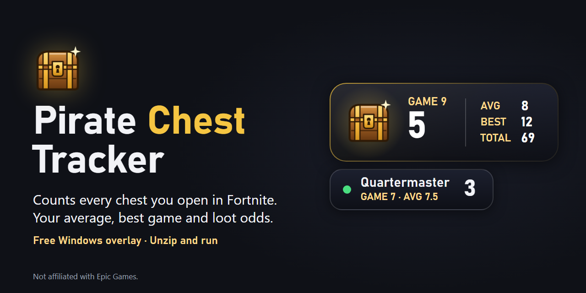
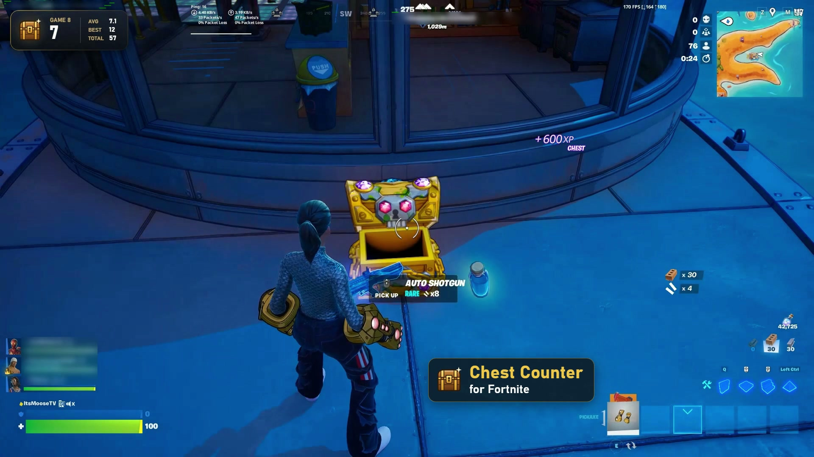
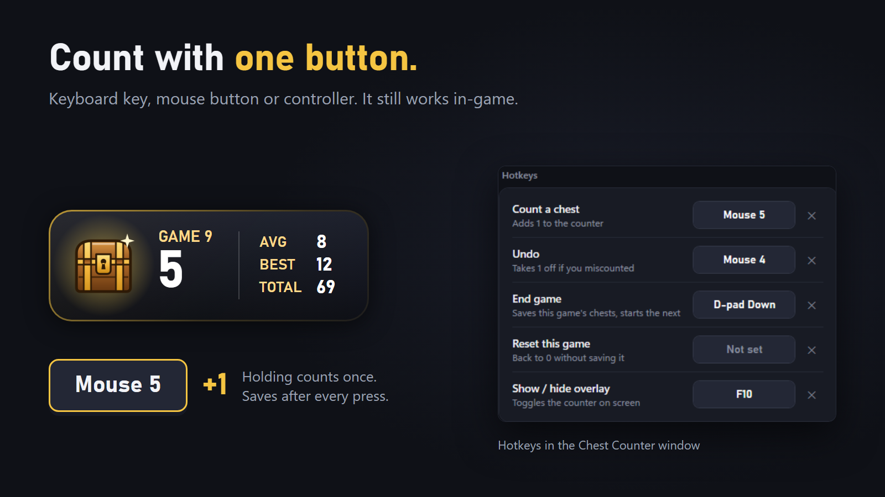
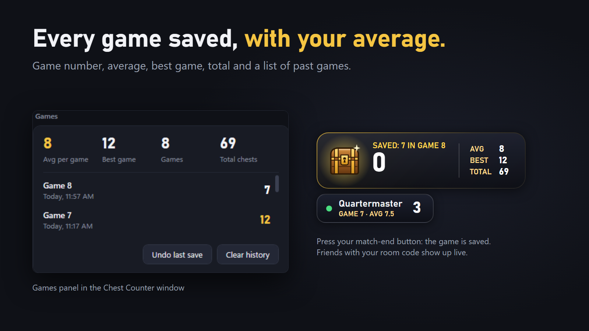
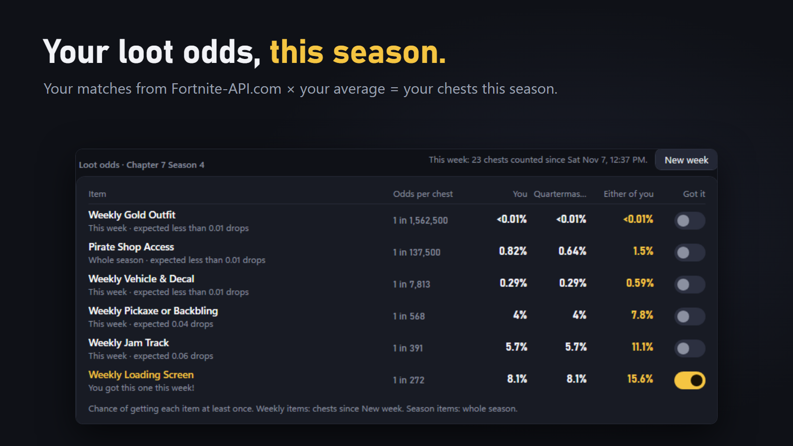

# Pirate Chest Tracker

**Chest Counter** is a small, good-looking overlay that counts the chests you open in Fortnite. Press a button when you open a chest, press another when the match ends, and it keeps your per-game average, your season loot odds, and (optionally) a live view of a friend's counter.

**[Download the latest release](../../releases/latest)** · Free · Windows · Unzip and run

## See it in action

[](docs/media/pirate-chest-tracker.mp4)

*Click to watch the 23-second demo.*

> Not affiliated with or endorsed by Epic Games. Fortnite is a trademark of Epic Games, Inc.

## Download

Grab `ChestCounter.zip` from the [latest release](../../releases/latest), unzip, and run `ChestCounter.exe`. No install needed. Each release lists a SHA-256 checksum, and every release is built from this repository's source by GitHub Actions.

Windows will show "Windows protected your PC" because the exe isn't code-signed. Click **More info → Run anyway**.

## Features

- **Overlay in the top-left** on top of Fortnite (Window Mode: *Windowed Fullscreen*). Click-through, so it never gets in the way.
- **Any button:** keyboard keys, mouse buttons (Mouse 4/5), or controller buttons (Xbox controllers, or others via Steam Input / DS4Windows). Your button still works in-game as normal.
- **Per-game stats:** game number, average chests per game, best game, total, and a list of past games.
- **Season odds:** pulls this season's matches from [Fortnite-API.com](https://fortnite-api.com) (free key), estimates your chests this season, and shows your chance of getting each loot item. Mark items off when you get them.
- **Weekly items:** press *New week* when the week resets and weekly items count only that week's chests, while season items (like Pirate Shop Access) keep counting the whole season.
- **Friends:** share a room code to see each other's counters and odds live.
- **Only while Fortnite is open:** the overlay hides itself when you're not playing.
- **Automatic End game (optional, off by default):** saves each game for you when Fortnite records the match. It splits by the time the match ended, so chests you open in the next game stay in the next game even though the stats arrive a few minutes late.
- **Update check:** tells you when a new release is out. Your stats carry over.

### One button per chest



### Every game saved



### Your loot odds



## Does it touch the game?

No. Chest Counter never reads or changes Fortnite's memory or files. It's a separate always-on-top window that listens for the button you picked, the same way Discord push-to-talk works.

## Privacy

- Stats are stored locally in `%APPDATA%\ChestCounter`.
- Friend sharing (off by default) sends your name and chest stats through the public MQTT server `broker.emqx.io`. Anyone with your room code can see them.
- Season odds sends your Epic name and your own API key to Fortnite-API.com.

## Updating the loot odds each season

The odds live in [`loot.json`](loot.json). Each item has `oneIn` (odds per chest) and `weekly` (true if it has a fresh chance every week). Edit it on `main` and every copy of the app picks up the new table on its next start. No new release needed.

## Building

Requires the .NET 10 SDK on Windows.

```
dotnet publish ChestCounter.csproj -c Release -r win-x64 --self-contained true -p:PublishSingleFile=true -p:IncludeNativeLibrariesForSelfExtract=true -p:EnableCompressionInSingleFile=true -p:DebugType=none -o dist
```

To release: push a tag like `v1.1.0` (the repo is set in `AppInfo.cs` as `RepoSlug`). GitHub Actions builds the zip, adds a checksum, and publishes the release.

For testing, `ChestCounter.exe --profile Test` runs a separate copy with its own settings folder.
